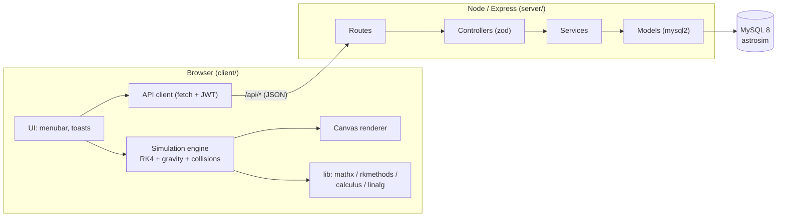

# AstroSim

**A black-hole & star simulator** — a real-time 2-D N-body sandbox with a Newtonian
(and optional relativistic) physics core, a canvas renderer, an Express/TypeScript
API and MySQL persistence.

> AstroSim is a TypeScript monorepo. The simulation runs entirely in the browser;
> the server is a stateless REST API that stores scenes, presets, quantitative
> "experiments" and an audit trail.

---

## Table of contents

- [Features](#features)
- [Architecture at a glance](#architecture-at-a-glance)
- [Repository layout](#repository-layout)
- [Quick start](#quick-start)
- [Environment variables](#environment-variables)
- [Available scripts](#available-scripts)
- [The physics in one page](#the-physics-in-one-page)
- [HTTP API summary](#http-api-summary)
- [Documentation](#documentation)
- [Testing & quality gates](#testing--quality-gates)
- [License](#license)

---

## Features

**Simulation engine**

- Fixed-step **RK4** integrator with adaptive sub-stepping (`advance()`).
- Pairwise **Newtonian gravity** with Plummer softening; optional **GR correction**
  (Einstein–Infeld–Hoffmann-like `1/c²` term).
- **Collision handling**: `merge` (perfectly inelastic, momentum + mass conserving),
  `bounce` (restitution), or `none`.
- Energy/potential/kinetic bookkeeping with an **energy-drift** metric.
- Body kinds: `star`, `planet`, `blackhole`, `neutron`, `dust`, `ship`.
- Per-body **trails**, **fixed** anchors, temperature, luminosity and spin.

**Math & physics libraries**

- `mathx` — vectors, statistics, EMA, root finding (bisection / secant / Newton),
  interpolation, scientific-notation formatting.
- `rkmethods` — Euler, midpoint, Heun, RK4, RK45, and an `integrate()` driver.
- `calculus` — numerical derivatives (incl. Richardson), gradients/Jacobians/curl,
  quadrature (trapezoid, Simpson, adaptive Simpson, Gauss–Legendre, Romberg),
  arc length, work, gravitational potential/field.
- `linalg` — LU, determinant, solve, inverse, rank, Cholesky, QR, power iteration,
  rotation matrices, small-matrix fast paths.
- Domain modules: `blackhole`, `star`, `relativity`, `photonsphere`.

**Server**

- Express 4 + TypeScript, strict config validated at boot.
- JWT bearer auth (`bcryptjs` hashes), optional/required/role guards.
- Zod-validated request bodies and queries; scene normaliser that clamps all ranges.
- Rate limiting (global + stricter for credentials), Helmet, CORS, compression.
- Uniform `{ data, meta? }` success envelopes and `{ error: { code, message } }` failures.
- Fire-and-forget audit logging to `api_events`.

**Persistence**

- MySQL 8 schema with `users`, `simulations`, `bodies`, `presets`, `experiments`,
  `api_events`, `schema_migrations`, plus a `v_simulation_summary` view.
- The authoritative scene is a JSON document in `simulations.settings`; `bodies`
  is a normalised mirror for cross-simulation queries.

---

## Architecture at a glance



See [`docs/ARCHITECTURE.md`](docs/ARCHITECTURE.md) for the full breakdown and
[`docs/uml/`](docs/uml) for class, sequence and ER diagrams.

---

## Repository layout

```
.
├── client/                      # Browser application (Vite + TypeScript)
│   ├── src/
│   │   ├── sim/                 # Physics core: engine, gravity, collisions, presets
│   │   ├── lib/                 # Numeric foundation: mathx, calculus, linalg, rkmethods
│   │   ├── render/              # 2-D canvas renderer + camera
│   │   ├── ui/                  # Menubar and toast notifications
│   │   ├── api/                 # Typed fetch wrappers per resource
│   │   └── types/               # Shared client types
│   └── vite.config.ts           # Aliases (@sim, @lib, …) + /api dev proxy
├── server/                      # REST API (Express + TypeScript)
│   ├── src/
│   │   ├── routes/              # URL → controller wiring
│   │   ├── controllers/         # HTTP layer + zod schemas
│   │   ├── services/            # Business rules (limits, ownership, audit)
│   │   ├── models/              # SQL / row mapping (mysql2)
│   │   ├── middleware/          # auth, validation, rate limit, ids, errors
│   │   ├── database/            # pool, migrate, seed, reset, sqlRunner
│   │   ├── config/              # env loader + constants
│   │   ├── utils/               # jwt, password, errors, response, logger, sanitize
│   │   └── tests/               # node:test unit tests
│   └── .env.example
├── database/                    # schema.sql + seed.sql
├── docs/                        # This documentation set (+ uml/)
├── css/ , js/ , index.html      # Legacy static assets
├── package.json                 # npm workspaces: server, client
└── tsconfig.base.json           # Shared strict compiler options
```

---

## Quick start

**Prerequisites:** Node.js ≥ 18 and a running MySQL 8 instance.

```bash
# 1. Install workspace dependencies (root, server, client)
npm install

# 2. Configure the environment
copy .env.example .env          # Windows (PowerShell)
# cp .env.example .env          # macOS / Linux
#   -> edit DB_* and JWT_SECRET

# 3. Create the schema and load built-in presets
npm run db:migrate
npm run db:seed

# 4. Run both dev servers (API on :4000, client on :5173)
npm run dev
```

Open <http://localhost:5173>. The Vite dev server proxies `/api` to the API on
`http://127.0.0.1:4000`, so no CORS configuration is needed during development.

### Single-origin production build

```bash
npm run build        # builds server (tsc) then client (vite)
npm run start        # serve the API; set SERVE_CLIENT=true to also serve client/dist
```

---

## Environment variables

Copy [`.env.example`](.env.example) to `.env` at the repository root (the server
also falls back to `server/.env`). The full list with defaults and descriptions is
in [`docs/ARCHITECTURE.md`](docs/ARCHITECTURE.md#configuration); the essentials:

| Variable | Default | Purpose |
| --- | --- | --- |
| `NODE_ENV` | `development` | `development` \| `production` \| `test` |
| `PORT` / `HOST` | `4000` / `127.0.0.1` | API bind address |
| `CORS_ORIGINS` | `http://localhost:5173,...` | Comma-separated allowed origins |
| `DB_HOST` `DB_PORT` `DB_USER` `DB_PASSWORD` `DB_NAME` | `127.0.0.1` `3306` `root` `` `astrosim` | MySQL connection |
| `JWT_SECRET` | dev placeholder | **Must** be ≥ 32 chars in production (boot fails otherwise) |
| `JWT_EXPIRES_IN` | `7d` | Token lifetime |
| `BCRYPT_ROUNDS` | `10` | Password hashing cost |
| `RATE_LIMIT_WINDOW_MS` / `RATE_LIMIT_MAX` | `900000` / `300` | Global throttle |
| `MAX_SIMULATIONS_PER_USER` | `50` | Create limit (409 on exceed) |
| `MAX_BODIES_PER_SIMULATION` | `500` | Scene size cap enforced by the validator |
| `SERVE_CLIENT` | `false` | Serve `client/dist` from Express |

---

## Available scripts

Run from the repository root:

| Script | Description |
| --- | --- |
| `npm run dev` | API + client together (concurrently) |
| `npm run dev:server` / `npm run dev:client` | One side only |
| `npm run build` | Build server then client |
| `npm run start` | Start the compiled API |
| `npm run typecheck` | `tsc --noEmit` for server **and** client |
| `npm test` | Compile + run server unit tests (`node:test`) |
| `npm run lint` | ESLint over `*.ts` |
| `npm run db:migrate` | Apply `database/schema.sql` |
| `npm run db:seed` | Load `database/seed.sql` (built-in presets) |
| `npm run db:reset` | **Destructive** drop + migrate + seed (refuses in production) |

---

## The physics in one page

State is packed as `y = [x…, y…, vx…, vy…]` for `n` bodies (`4n` numbers). One
`step(dt)` performs a classic **RK4** advance:

1. The derivative `f(t, y)` copies velocities into position slots, writes the
   candidate state into the bodies, calls `computeAccelerations()` (O(n²)
   pairwise Newtonian gravity + optional GR term), reads the accelerations back
   out, then restores the bodies so a rejected sub-step cannot corrupt state.
2. Collisions are resolved after the step (`merge` / `bounce`) and dead bodies pruned.
3. Every surviving body pushes its position onto its trail ring buffer.

`advance(realDtSeconds)` sizes the sub-step count from the frame delta, clamped to
`MAX_SUBSTEPS`, keeping integration stable regardless of frame rate.

Key formulas:

| Quantity | Formula |
| --- | --- |
| Gravitational acceleration | `aᵢ = Σⱼ G·mⱼ·(rⱼ − rᵢ) / (|rⱼ − rᵢ|² + ε²)^{3/2}` |
| Kinetic / potential energy | `½mv²` ; `−G·mᵢ·mⱼ / r` |
| Schwarzschild radius | `r_s = 2GM/c²` |
| Photon sphere / ISCO / shadow | `1.5 r_s` / `3 r_s` / `(3√3 / 2) r_s` |
| Circular / escape speed | `√(GM/r)` / `√(2GM/r)` |
| Mass–luminosity (main sequence) | `L ∝ M^3.5` |
| Hawking temperature | `T = ħc³ / (8πGMk_B)` |

Full derivations, constants and units: [`docs/SIMULATION.md`](docs/SIMULATION.md).

---

## HTTP API summary

Base path `/api`. All success responses are `{ "data": … }` (`meta` on lists);
errors are `{ "error": { "code", "message", "details? } }`.

| Method | Path | Auth | Purpose |
| --- | --- | --- | --- |
| `GET` | `/health` · `/health/live` · `/health/ready` | — | Readiness / liveness |
| `POST` | `/auth/register` · `/auth/login` | — | Issue a JWT |
| `POST` | `/auth/logout` · `GET /auth/me` | ✅ | Session maintenance |
| `GET` | `/simulations` | optional | List / search / paginate |
| `POST` | `/simulations` | ✅ | Create a saved scene |
| `GET` `PATCH` `DELETE` | `/simulations/:id` | optional / ✅ / ✅ | Fetch, update, delete |
| `POST` | `/simulations/:id/play` | optional | Increment play counter |
| `GET` | `/simulations/:id/bodies` | optional | Normalised body mirror |
| `GET` | `/presets` · `/presets/:key` | — | Built-in preset catalogue |
| `GET` `POST` `DELETE` | `/experiments` · `/experiments/:id` | ✅ | Quantitative runs |
| `GET` | `/experiments/simulation/:id` | optional | Runs for one simulation |
| `GET` | `/bodies/histogram` · `/bodies/kind/:kind` | — | Cross-simulation aggregates |

Full request/response schemas, status codes and examples:
[`docs/API.md`](docs/API.md).

---

## Documentation

| Document | Contents |
| --- | --- |
| [`docs/ARCHITECTURE.md`](docs/ARCHITECTURE.md) | Layering, request lifecycle, configuration, deployment |
| [`docs/API.md`](docs/API.md) | Every endpoint, payloads, errors, pagination |
| [`docs/SIMULATION.md`](docs/SIMULATION.md) | Integrators, gravity, collisions, domain physics |
| [`docs/DATABASE.md`](docs/DATABASE.md) | Schema, relationships, migrations, queries |
| [`docs/CONTRIBUTING.md`](docs/CONTRIBUTING.md) | Setup, conventions, workflow, code style |
| [`docs/CHANGELOG.md`](docs/CHANGELOG.md) | Version history |
| [`docs/uml/`](docs/uml) | Mermaid + PlantUML diagrams (class, sequence, ER, state, activity, component) |
| [`docs/README.md`](docs/README.md) | Documentation index |

---

## Testing & quality gates

```bash
npm run typecheck   # strict TypeScript across both workspaces
npm test            # node:test unit tests (compile to dist, then run)
npm run lint        # eslint
```

Server unit tests live in `server/src/tests/` and cover row mapping, the scene
validator, the SQL splitter and shared utilities.

---

## License

[MIT](LICENSE) © AstroSim contributors.
