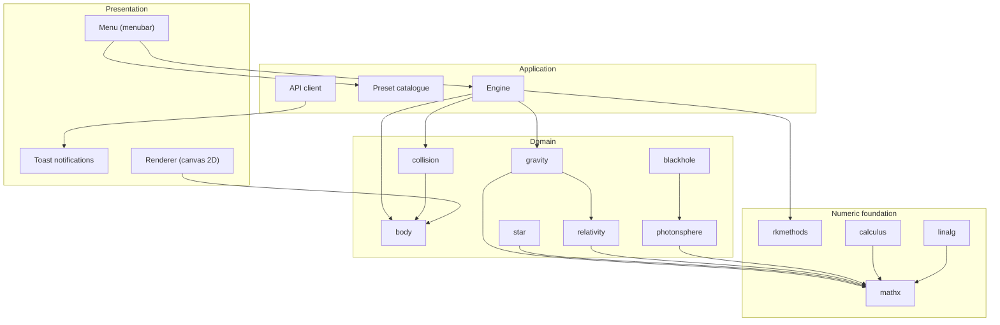
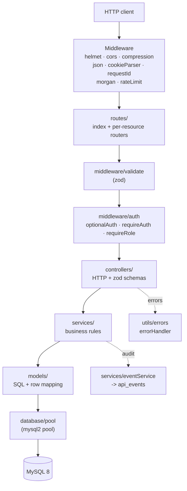
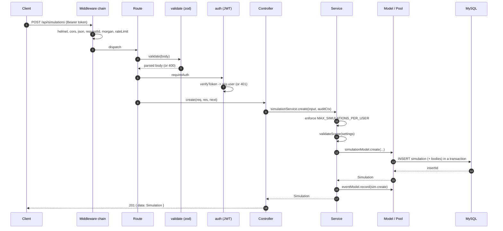

# Architecture

This document describes how AstroSim is put together: the workspace layout, the
runtime layering on both sides, the request lifecycle, configuration, error
handling and deployment options.

---

## 1. Workspace topology

AstroSim is an **npm workspaces** monorepo. The root `package.json` declares two
workspaces and orchestrates them; it contains no runtime code of its own.

```
astrosim/
├── package.json          # workspaces: ["server", "client"], orchestration scripts
├── tsconfig.base.json    # shared strict compiler options (server extends this)
├── .env.example          # canonical environment template
├── database/             # schema.sql, seed.sql — applied by server scripts
├── server/               # @astrosim/server  (Express + TypeScript)
├── client/               # @astrosim/client  (Vite + TypeScript)
├── docs/                 # this documentation set
└── css/ js/ index.html   # legacy static assets (not part of the build)
```

Why a monorepo: the client and server share the same **scene document** shape
(`SceneSettings`, `BodySpec`, `GravitySettings`, `CameraSettings`). Keeping both
in one repository makes it obvious when one side's contract drifts from the
other, and a single `npm install` wires up everything.

---

## 2. High-level component view



---

## 3. Client architecture (`client/`)

Layered bottom-up. Each layer may depend only on the layers beneath it.

| Layer | Module | Responsibility |
| --- | --- | --- |
| **Numeric foundation** | `lib/mathx.ts` | Vectors (`V`), stats (`S`), `EMA`, root finding (`R`), interpolation (`I`), formatting. |
| | `lib/rkmethods.ts` | `eulerStep`, `midpointStep`, `heunStep`, `rk4Step`, `rk45Step`, `integrate`, `STEPPERS` dispatch. |
| | `lib/calculus.ts` | Derivatives, gradients/Jacobians/curl, quadrature, arc length, work, gravitational potential/field. |
| | `lib/linalg.ts` | LU/solve/inverse/det/rank, Cholesky, QR, power iteration, rotations, 2×2 & 3×3 fast paths. |
| **Domain physics** | `sim/constants.ts` | Physical + integration + renderer constants and `BodyKind`. |
| | `sim/body.ts` | `Body` class (mutable state, trail, energies, spec round-trip). |
| | `sim/gravity.ts` | `computeAccelerations`, energies, momentum, centre of mass, orbit helpers. |
| | `sim/collision.ts` | `detect`, `bounce`, `merge`, `resolve`, `prune`. |
| | `sim/relativity.ts` | Lorentz factor, GR correction, precession, redshift, aberration. |
| | `sim/blackhole.ts` | Schwarzschild/Kerr geometry bundle, Hawking temperature, evaporation. |
| | `sim/star.ts` | Mass–luminosity, radius, spectral class, colour, fusion lifetime. |
| | `sim/photonsphere.ts` | Deflection, Einstein radius, critical impact parameter, Shapiro delay. |
| **Simulation** | `sim/engine.ts` | Owns bodies; `loadScene`, `step`, `advance`, energy bookkeeping, snapshots. |
| | `sim/presets.ts` | Built-in scene catalogue (mirrors `database/seed.sql`). |
| **Presentation** | `render/renderer.ts` | Camera transforms, world↔screen, drawing bodies/trails/grid/velocity, DPR handling. |
| | `ui/menu.ts` | Menubar with dropdowns and render/playback toggles. |
| | `ui/toast.ts` | Transient notifications. |
| **Integration** | `api/*.ts` | Typed `fetch` wrappers (`client`, `authApi`, `simulationApi`, `presetApi`, `experimentApi`, `healthApi`). |

### Engine ownership model

The `Engine` is the single source of truth for simulation state. It owns a
`Body[]`, the active `GravitySettings`, the `CollisionMode`, the fixed `dt`, and
the accumulated `time`/`steps`. Scenes move in and out of the engine as plain
**specs** — `loadScene(SceneSettings)` on the way in, `toScene()` / `snapshot()`
on the way out — which keeps the engine decoupled from the renderer and from the
API client.

### Module resolution

Vite aliases keep import paths readable and stable across moves
(`client/vite.config.ts`):

| Alias | Target |
| --- | --- |
| `@` | `client/src` |
| `@lib` | `client/src/lib` |
| `@sim` | `client/src/sim` |
| `@render` | `client/src/render` |
| `@ui` | `client/src/ui` |
| `@api` | `client/src/api` |

The production build splits shared code into chunks (`math` and `sim`) so the
numeric library is cached independently of app code.

---

## 4. Server architecture (`server/`)

Classic layered Express application. Dependencies point **downward only**.



### Layer responsibilities

- **middleware/** — cross-cutting concerns, applied in `app.ts` in a fixed order.
  `requestId` attaches `X-Request-Id`; `rateLimit` throttles; `validate` replaces
  `req.body|query|params` with the zod-parsed result; `auth` populates `req.user`.
- **routes/** — pure wiring: path + method + guard + validator + controller. No
  business logic.
- **controllers/** — HTTP translation only. Export zod schemas, read validated
  input, call exactly one service, and shape the response through
  `utils/response` (`ok`, `created`, `noContent`, `pagination`). Errors go to
  `next()`.
- **services/** — business rules that must be enforced regardless of caller:
  per-user simulation limits, ownership/visibility checks, scene validation,
  play counting, audit events.
- **models/** — SQL and **row → domain object** mapping (snake_case columns,
  `0/1` booleans and JSON columns become camelCase objects). This is the only
  layer aware of the database shape.
- **database/pool.ts** — a single `mysql2/promise` pool plus `query`, `execute`,
  `ping`, `withTransaction`, `closePool`.

### Request lifecycle



Any error thrown along the way is forwarded to `next(err)` and terminated by the
central `errorHandler`, which maps `AppError` (and unknown errors → 500) to the
`{ error: { code, message, details? } }` body.

### Error model

`utils/errors.ts` defines `AppError` with a `statusCode` and machine-readable
`code`, plus factory helpers used throughout:

| Helper | Status | Code |
| --- | --- | --- |
| `badRequest` | 400 | `BAD_REQUEST` |
| `unauthorized` | 401 | `UNAUTHORIZED` |
| `forbidden` | 403 | `FORBIDDEN` |
| `notFound` | 404 | `NOT_FOUND` |
| `conflict` | 409 | `CONFLICT` |
| `tooMany` | 429 | `RATE_LIMITED` |
| `internal` | 500 | `INTERNAL` |

Server errors (≥ 500) are logged with a stack trace; client errors are logged at
debug level only in development.

---

## 5. Shared contract: the scene document

The unit of exchange between client, server and database is a serialisable
**scene**, stored verbatim in `simulations.settings` and in `presets.settings`:

```jsonc
{
  "bodies": [
    {
      "name": "Sol", "kind": "star", "mass": 90000, "radius": 34,
      "x": 0, "y": 0, "vx": 0, "vy": 0, "color": "#fff2b8",
      "temperature": 5778, "luminosity": 1, "spin": 0,
      "fixed": true, "trailLength": 240
    }
  ],
  "gravity": { "G": 1, "softening": 6, "relativistic": false },
  "camera":  { "x": 0, "y": 0, "zoom": 0.75 }
}
```

The server never trusts this blob: `services/sceneValidator.ts` clamps every
numeric field to a safe range, rejects unknown `kind` values, coerces colours to
a valid hex or a default, and enforces `MAX_BODIES_PER_SIMULATION`. The client
types in `client/src/types/index.ts` mirror the server's `server/src/types/index.ts`.

> **Consistency note:** `bodies` is a *derived* mirror. Whenever `settings`
> changes, `simulationModel.update` deletes and re-inserts the mirror rows inside
> the same transaction, so the two representations cannot diverge.

---

## 6. Configuration

`server/src/config/env.ts` loads `.env` from `process.cwd()` and then `../.env`,
coerces every value (`str`/`num`/`bool` with fallbacks) and exposes a frozen
`env` object. Missing required values throw at boot; in production a
`JWT_SECRET` containing `dev_only` is rejected outright — the server refuses to
start rather than run with a placeholder secret.

The full variable reference is in the [README](../README.md#environment-variables)
and [`server/.env.example`](../server/.env.example).

| Group | Variables |
| --- | --- |
| Runtime | `NODE_ENV`, `PORT`, `HOST`, `CORS_ORIGINS`, `TRUST_PROXY` |
| MySQL | `DB_HOST`, `DB_PORT`, `DB_USER`, `DB_PASSWORD`, `DB_NAME`, `DB_CONNECTION_LIMIT`, `DB_QUEUE_LIMIT`, `DB_CONNECT_TIMEOUT`, `DB_SSL`, `DB_SSL_CA` |
| Security | `JWT_SECRET`, `JWT_EXPIRES_IN`, `BCRYPT_ROUNDS` |
| Limits | `RATE_LIMIT_WINDOW_MS`, `RATE_LIMIT_MAX`, `JSON_BODY_LIMIT`, `MAX_SIMULATIONS_PER_USER`, `MAX_BODIES_PER_SIMULATION` |
| Misc | `LOG_LEVEL`, `LOG_PRETTY`, `SERVE_CLIENT` |

---

## 7. Security posture

- **Passwords** — hashed with `bcryptjs` at `BCRYPT_ROUNDS` (default 10); the
  hash column is `VARCHAR(72)`, sized for bcrypt output.
- **Sessions** — stateless JWTs (`sub`, `username`, `role`) accepted from the
  `Authorization: Bearer` header or a `token` cookie; `verifyToken` rejects
  malformed payloads with a 401.
- **Visibility** — scenes are private by default. `getVisible` allows the owner,
  an admin, or anyone if `is_public`; mutations require ownership or admin.
- **Throttling** — a global limiter for `/api` and a stricter one for
  `/auth/register` and `/auth/login`.
- **Headers** — Helmet (CSP enabled in production only), CORS allow-list from
  `CORS_ORIGINS`, `compression`, and a `JSON_BODY_LIMIT` on parsers.
- **Injection** — every query uses bound parameters via `mysql2`; `multipleStatements`
  is off. `sanitizeUsername`/`normalizeEmail`/`collapse` clean user input.
- **Auditing** — auth, simulation and experiment mutations append to `api_events`
  (fire-and-forget, never able to break a request).

---

## 8. Deployment

**Development** — two processes; the Vite dev server proxies `/api` to the API.

```bash
npm run dev
```

**Single origin (recommended for production)** — build both, then serve the API
with `SERVE_CLIENT=true`. Express serves `client/dist` statically and falls back
to `index.html` for client-side routes.

```bash
npm run build
SERVE_CLIENT=true npm run start     # PowerShell: $env:SERVE_CLIENT="true"; npm run start
```

**Split origin** — host `client/dist` on a CDN/static host and add its origin to
`CORS_ORIGINS`; the client then calls the API cross-origin with credentials.

The server handles `SIGINT`/`SIGTERM` by closing the HTTP server, draining the
MySQL pool, and exiting (with a 10-second force-exit guard). It also logs
`unhandledRejection` and `uncaughtException` before shutting down.

---

## 9. Design principles & known trade-offs

**Principles**

1. **Physics is pure** — the `lib/` and `sim/` modules are side-effect-free
   functions plus one stateful `Body` class; they can be unit-tested without a DOM.
2. **Specs at the boundaries** — scenes cross module and network boundaries as
   plain JSON, never as live `Body` instances.
3. **One way to talk to MySQL** — all access funnels through `database/pool`.
4. **Validate at the edge** — zod at the HTTP layer, the scene validator at the
   persistence boundary, `Body`/`computeAccelerations` internally.
5. **Uniform shapes** — every response is an envelope; every error is `{ code, message }`.

**Trade-offs**

- **O(n²) gravity** — fine for the hundreds of bodies the simulator targets, but
  a tree code (Barnes–Hut) or grid would be required for thousands.
- **No server-side simulation** — the server stores and validates scenes but does
  not run step loops, so there is no authoritative replay beyond the seed.
- **Forward-only migrations** — `db:migrate` applies `schema.sql` and records a
  checksum; there is no down-migration. `db:reset` is the escape hatch for dev.
- **Dual scene representation** — the JSON document plus the normalised `bodies`
  table must be kept in sync; this is handled transactionally in the model layer.
