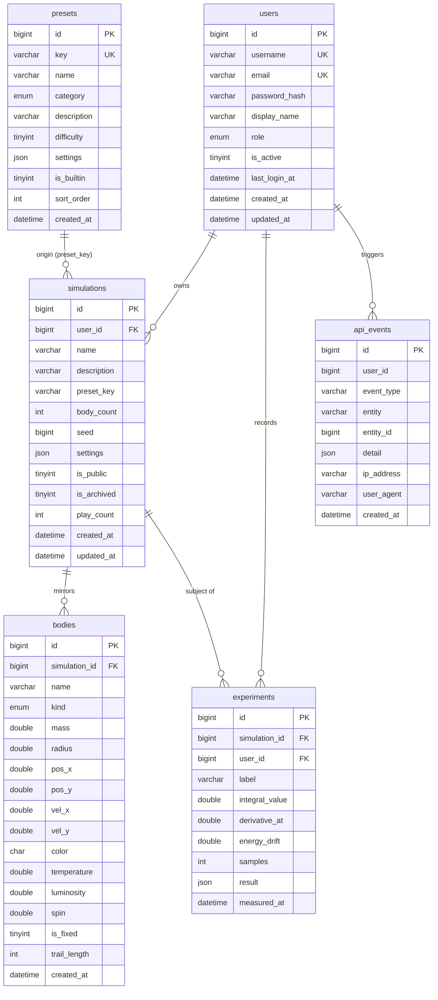
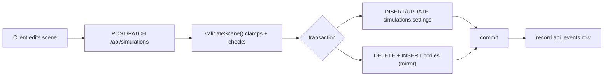

# Database

AstroSim persists everything in a single MySQL 8 schema named `astrosim`
(configurable via `DB_NAME`). All tables use **InnoDB** with **utf8mb4** so JSON
documents and arbitrary display names work correctly.

- Canonical DDL: [`database/schema.sql`](../database/schema.sql)
- Seed data: [`database/seed.sql`](../database/seed.sql)
- Runner code: `server/src/database/` (`migrate.ts`, `seed.ts`, `reset.ts`, `pool.ts`, `sqlRunner.ts`)

---

## 1. Entity-relationship overview



---

## 2. Tables

### `users`

Accounts and credentials. `password_hash` is a bcrypt digest (`VARCHAR(72)`
matches bcrypt output). `role` is an `ENUM('user','admin')`. Uniqueness is
enforced on both `username` and `email`.

| Column | Type | Notes |
| --- | --- | --- |
| `id` | `BIGINT UNSIGNED` PK | Auto-increment |
| `username` | `VARCHAR(32)` | Unique; sanitised to `[a-zA-Z0-9_.-]` |
| `email` | `VARCHAR(190)` | Unique; lower-cased on write |
| `password_hash` | `VARCHAR(72)` | bcrypt |
| `display_name` | `VARCHAR(64)` NULL | Falls back to username |
| `role` | `ENUM('user','admin')` | Default `user`; indexed |
| `is_active` | `TINYINT(1)` | `0` disables login |
| `last_login_at` | `DATETIME` NULL | Updated on successful login |
| `created_at` / `updated_at` | `DATETIME` | `updated_at` auto-updates |

### `simulations`

One saved scene per row. `settings` is the **authoritative** JSON document
(bodies + gravity + camera); `body_count` denormalises the length; `seed` records
the RNG seed used when the scene was generated.

| Column | Type | Notes |
| --- | --- | --- |
| `id` | `BIGINT UNSIGNED` PK | |
| `user_id` | `BIGINT UNSIGNED` FK → `users.id` | `ON DELETE CASCADE` |
| `name` | `VARCHAR(120)` | |
| `description` | `VARCHAR(500)` NULL | |
| `preset_key` | `VARCHAR(60)` NULL | Soft link to `presets.key` (not a FK) |
| `body_count` | `INT UNSIGNED` | Mirror of `settings.bodies.length` |
| `seed` | `BIGINT UNSIGNED` NULL | |
| `settings` | `JSON` | The scene document |
| `is_public` | `TINYINT(1)` | Default `0` (private) |
| `is_archived` | `TINYINT(1)` | Archived scenes are excluded from lists and limits |
| `play_count` | `INT UNSIGNED` | Incremented by `POST /:id/play` |
| `created_at` / `updated_at` | `DATETIME` | |

Indexes: `ix_sim_user`, `ix_sim_public (is_public, is_archived)`, `ix_sim_preset`,
and a `FULLTEXT` index `ft_sim_name (name, description)`.

### `bodies`

A **normalised mirror** of `settings.bodies`, written whenever a scene is created
or updated (delete-and-reinsert inside one transaction). Its purpose is
cross-simulation querying/aggregation — e.g. "every black hole", "kind
histogram" — which is awkward over JSON. The JSON document remains authoritative.

| Column | Type | Notes |
| --- | --- | --- |
| `id` | `BIGINT UNSIGNED` PK | |
| `simulation_id` | FK → `simulations.id` | `ON DELETE CASCADE` |
| `name` | `VARCHAR(80)` | |
| `kind` | `ENUM('star','planet','blackhole','neutron','dust','ship')` | Indexed |
| `mass` `radius` | `DOUBLE` | |
| `pos_x` `pos_y` `vel_x` `vel_y` | `DOUBLE` | |
| `color` | `CHAR(7)` | `#rrggbb` |
| `temperature` `luminosity` `spin` | `DOUBLE` | |
| `is_fixed` | `TINYINT(1)` | |
| `trail_length` | `INT UNSIGNED` | Default `240` |
| `created_at` | `DATETIME` | |

### `presets`

Seeded catalogue of reusable scenes. `key` is the stable identifier the client
uses (`presetScene(key)`); `category` drives grouping; `sort_order` gives a
deterministic display order. Built-in presets have `is_builtin = 1`.

| Column | Type | Notes |
| --- | --- | --- |
| `key` | `VARCHAR(60)` | **Unique** |
| `category` | `ENUM('blackhole','stellar','orbital','exotic','sandbox')` | Indexed with `sort_order` |
| `difficulty` | `TINYINT UNSIGNED` | 1–5 |
| `settings` | `JSON` | Same `SceneSettings` shape |

The set is mirrored in `client/src/sim/presets.ts` so the UI can offer presets
without a round trip.

### `experiments`

Quantitative results produced by the client's calculus tooling: an integral value,
a derivative sample, an energy-drift measurement, the sample count, and a
free-form JSON `result`. `simulation_id` is nullable and uses
`ON DELETE SET NULL`, so a run can outlive the scene it referenced.

### `api_events`

Append-only audit/telemetry trail. Writes are fire-and-forget — a failure is
logged and swallowed so telemetry can never break a request. Event types come
from `server/src/config/constants.ts`:

`auth.register`, `auth.login`, `auth.logout`, `sim.create`, `sim.update`,
`sim.delete`, `sim.play`, `experiment.create`, `experiment.delete`.

### `schema_migrations`

Bookkeeping for applied migrations: `filename` (unique) and a SHA-256 `checksum`
of the applied SQL, recorded by `migrate.ts`.

### View `v_simulation_summary`

Convenience join used by `simulationModel.summary()`:

```
simulations ⋈ users  →  id, name, preset_key, body_count, is_public,
                        created_at, updated_at, owner(username)
        + left-joined per-simulation kind counts:
          black_holes, stars, planets
```

`planets` aggregates `planet`, `dust`, `ship` and `neutron`.

---

## 3. Referential integrity

| Constraint | Behaviour |
| --- | --- |
| `fk_sim_user` | Deleting a user **cascades** to their simulations |
| `fk_bodies_sim` | Deleting a simulation **cascades** to its body mirrors |
| `fk_exp_sim` | Deleting a simulation **sets** `experiments.simulation_id` to `NULL` |
| `fk_exp_user` | Deleting a user **cascades** to their experiments |

`api_events.user_id` and `presets` have no foreign keys (events must survive
account deletion; presets are a standalone catalogue). `simulations.preset_key`
is intentionally a soft reference so presets can be renamed/removed without
breaking saved scenes.

---

## 4. Migrations & seeding

Scripts are run from the repository root (they resolve paths back to
`database/*.sql` via `process.cwd()`):

```bash
npm run db:migrate   # applies database/schema.sql, records the checksum
npm run db:seed      # loads database/seed.sql (built-in presets)
npm run db:reset     # DROP DATABASE + migrate + seed  (refuses in production)
```

**How `sqlRunner.ts` works.** `mysql2` refuses multiple statements unless
`multipleStatements` is enabled (which the pool keeps **off**). Instead the
runner:

1. `stripComments` removes `--` line comments and `/* … */` block comments while
   honouring quoted strings, so semicolons inside them are ignored.
2. `splitStatements` splits on **unquoted** semicolons (respecting `'`, `"`, and
   backtick quoting and backslash escapes).
3. `runScript` executes each statement in order and returns the count.

`migrate.ts` connects **without** a database so `CREATE DATABASE` can run, applies
the schema, then records `filename` + SHA-256 `checksum` in `schema_migrations`
(upsert on duplicate key).

`reset.ts` refuses to run when `NODE_ENV=production`.

---

## 5. Connection pool

`server/src/database/pool.ts` creates a single `mysql2/promise` pool:

| Setting | Value |
| --- | --- |
| `waitForConnections` | `true` |
| `connectionLimit` | `DB_CONNECTION_LIMIT` (default 10) |
| `queueLimit` | `DB_QUEUE_LIMIT` (default 0 = unlimited) |
| `connectTimeout` | `DB_CONNECT_TIMEOUT` (default 10000 ms) |
| `charset` | `utf8mb4_unicode_ci` |
| `supportBigNumbers` | `true` |
| `multipleStatements` | `false` (safety) |
| `ssl` | when `DB_SSL=true`, optionally with `DB_SSL_CA` |

Helpers: `query<T>(sql, params)` (reads), `execute(sql, params)` (writes,
returns a `ResultSetHeader`), `ping()` (health check), `withTransaction(fn)`
(begin → run → commit / rollback → release), and `closePool()` (graceful shutdown).

**Parameter binding.** Every query uses `?` placeholders; the pool never enables
multiple statements, so user input cannot be used for SQL injection.

---

## 6. Common queries

```sql
-- A user's active scenes, newest first
SELECT s.*, u.username AS owner
  FROM simulations s JOIN users u ON u.id = s.user_id
 WHERE s.user_id = ? AND s.is_archived = 0
 ORDER BY s.updated_at DESC LIMIT ? OFFSET ?;

-- Public catalogue search
SELECT * FROM simulations
 WHERE is_public = 1 AND is_archived = 0
   AND (name LIKE ? OR description LIKE ?)
 ORDER BY updated_at DESC;

-- Body-kind histogram across the database
SELECT kind, COUNT(*) AS total FROM bodies GROUP BY kind ORDER BY total DESC;

-- Ten heaviest bodies in a scene
SELECT * FROM bodies WHERE simulation_id = ? ORDER BY mass DESC LIMIT 10;

-- Summary view
SELECT * FROM v_simulation_summary LIMIT 20;
```

---

## 7. Data lifecycle



| Action | Effect |
| --- | --- |
| Create scene | Insert `simulations` + mirror `bodies`, `sim.create` event |
| Update scene (with `settings`) | Update `settings`/`body_count`, replace mirror, `sim.update` event |
| Play | `play_count += 1`, `sim.play` event |
| Delete scene | Cascade bodies, null out experiment links, `sim.delete` event |
| Delete user | Cascade simulations → bodies; cascade experiments; events retained |

---

## 8. Operational notes

- **Backups** — `mysqldump astrosim` captures everything; the JSON `settings`
  column makes scenes portable on their own.
- **Telemetry retention** — `eventModel.purgeOlderThan(days)` deletes old
  `api_events`; schedule it if the table grows.
- **Sequence limits** — `MAX_SIMULATIONS_PER_USER` (default 50) counts only
  **non-archived** scenes, so archiving frees a slot.
- **Scene size** — `MAX_BODIES_PER_SIMULATION` (default 500) caps both the JSON
  document and the mirror rows.
- **JSON handling** — `mysql2` may return JSON columns already parsed; every
  `parseSettings`/`parseJson` helper accepts either a string or an object.
- **Timezone** — driver returns `Date` objects (`dateStrings: false`); the models
  convert to ISO-8601 strings for the API.
