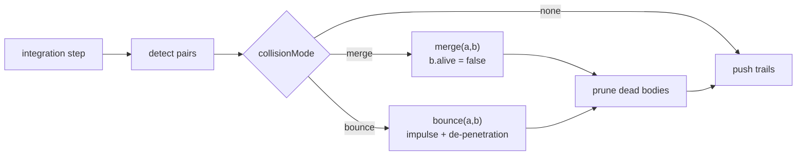

# Simulation & physics

How AstroSim turns forces into motion: the state vector, the integrators, the
gravity model, collision handling, and the domain-physics helpers for black
holes, stars and light.

> **Units.** AstroSim uses *simulation units*: `G = 1` by default, positions in
> arbitrary "world units", and a speed of light `C_LIGHT = 300` chosen only so
> relativistic terms produce visible effects. These are **not** SI. Where a
> helper needs real physics (Hawking temperature, evaporation) it converts to
> kilograms internally.

---

## 1. State representation

For `n` bodies the engine packs a flat state vector of length `4n`:

```
y = [ x₀ … xₙ₋₁ , y₀ … yₙ₋₁ , vx₀ … vxₙ₋₁ , vy₀ … vyₙ₋₁ ]
      \__ positions __/        \____ velocities ____/
```

`Engine.step(dt)` builds this vector from the live bodies, integrates, and writes
the result back. The first-order system is `y' = f(t, y)` where the derivative
copies velocities into the position slots and accelerations into the velocity
slots:

```ts
f(t, y) = [ v , a(x, v) ]
```

---

## 2. Integration

### Fixed-step RK4 (default)

`Engine.step()` uses `rk4Step` from `lib/rkmethods.ts`:

```
k₁ = f(t,        y)
k₂ = f(t + h/2,  y + h/2·k₁)
k₃ = f(t + h/2,  y + h/2·k₂)
k₄ = f(t + h,    y + h·k₃)

yₙ₊₁ = y + h/6·(k₁ + 2k₂ + 2k₃ + k₄)
```

Fourth-order accurate, with an error that scales as `O(h⁵)`. The default step
`DEFAULT_DT = 1/60` matches a 60 Hz display.

**State safety.** Each evaluation of `f` writes the candidate state into the
bodies so `computeAccelerations()` can read positions, then *restores* the saved
positions/velocities before returning. A sub-step that is later discarded
therefore cannot corrupt the live state.

### Adaptive sub-stepping

A frame may take longer than one `dt`. `Engine.advance(realDtSeconds)` scales by
`timeScale`, clamps the frame delta to at least `MIN_DT`, picks a sub-step count,
and runs that many fixed steps of equal size:

```
target = max(MIN_DT, realDt) · timeScale
sub    = clamp(round(target / dt), 1, MAX_SUBSTEPS)   // MAX_SUBSTEPS = 8
h      = target / sub
```

This decouples integration accuracy from frame rate: a slow frame is broken into
up to eight smaller, stable steps rather than one huge one.

### Available integrators

| Function | Order | Notes |
| --- | --- | --- |
| `eulerStep` | 1 | Baseline; fastest, least accurate. |
| `midpointStep` | 2 | RK2. |
| `heunStep` | 2 | Improved Euler. |
| `rk4Step` | 4 | **Engine default.** |
| `rk45Step` | 4(5) | Runge–Kutta–Fehlberg with an error estimate and `hNext` suggestion. |
| `integrate(f, y0, t0, t1, steps)` | 4 | Runs fixed-step RK4 over an interval, returning `[t, y]` samples. |
| `STEPPERS` / `step(method, …)` | — | Dispatch table keyed by `'euler' \| 'midpoint' \| 'heun' \| 'rk4'`. |

`rk45Step` returns `{ y, hNext, error }`, sizing the next step from the tolerance:
`hNext = h·clamp((tol/err)^0.2, 0.5, 2)`.

---

## 3. Gravity

### Pairwise Newtonian acceleration

`computeAccelerations()` accumulates, for every unordered pair `(i, j)`:

```
dx = xⱼ − xᵢ ,  dy = yⱼ − yᵢ
r² = dx² + dy² + ε²            (ε = softening)
f  = G / (r² · √r²)

aᵢ += f · mⱼ · (dx, dy)
aⱼ −= f · mᵢ · (dx, dy)
```

The Plummer **softening** `ε` prevents a singularity as two bodies approach, at
the cost of slightly weakening gravity at short range. Reset each frame, the
accelerations are cleared first; `fixed` bodies have their acceleration zeroed
after accumulation so they act as immovable anchors.

Complexity is **O(n²)** — adequate for the hundreds of bodies AstroSim targets.

### Optional relativistic correction

When `gravity.relativistic` is enabled, each pair also contributes a `1/c²`
Einstein–Infeld–Hoffmann-like term (`relativity.ts → grCorrection`):

```
r  = r_source − r_body ,  n = r/|r| ,  r = |r|
a_GR = (GM/r²) · ( 4GM/(r c²) − v²/c² ) · n
```

This bends orbits the way GR predicts (notably periapsis precession). It is an
**approximation for visual and qualitative effect**, not a geodesic integrator.

### Energies and conserved quantities

| Function | Quantity |
| --- | --- |
| `kineticEnergy(bodies)` | `Σ ½ m v²` |
| `potentialEnergy(bodies, settings)` | `−Σᵢ<ⱼ G mᵢ mⱼ / r` (softened) |
| `totalEnergy(bodies, settings)` | kinetic + potential |
| `totalMomentum(bodies)` | `(Σ m vₓ, Σ m v_y)` |
| `centerOfMass(bodies)` | mass-weighted mean position |
| `isBound(bodies, settings)` | `totalEnergy < 0` |

`Engine.energyDrift` compares the current total energy to the baseline captured
at `loadScene()` (resettable with `rebaseEnergy()`):

```
drift = (E_now − E_initial) / |E_initial|
```

Because RK4 is not symplectic, a small drift is expected; a large or growing
drift signals an unstable step size.

### Orbit helpers

- `circularSpeed(M, r, G)` = `√(GM/r)`
- `escapeSpeed(M, r, G)` = `√(2GM/r)`
- `setCircularOrbit(satellite, central, G, clockwise)` sets the perpendicular
  velocity needed for a circular orbit, relative to the central body's motion.

---

## 4. Collisions

Collisions are handled **after** each integration step, and only when
`collisionMode !== 'none'`. Each frame:

1. `detect(bodies)` finds every overlapping pair where `distance < rₐ + r_b`
   (skipping dead bodies).
2. The chosen mode resolves each pair: `merge` or `bounce`.
3. `prune(bodies)` removes bodies flagged `alive = false`.



### Merge (perfectly inelastic)

`merge(a, b)` conserves mass and momentum and folds `b` into `a`:

```
M = mₐ + m_b
v = (mₐ vₐ + m_b v_b) / M
x = (mₐ xₐ + m_b x_b) / M
radius = √(rₐ² + r_b²) · COLLISION_MERGE_FACTOR     (0.85)
luminosity += b.luminosity
temperature = max(tₐ, t_b)
```

`b.alive = false`. As a heuristic, a **neutron star** whose merged mass exceeds
`100000` is promoted to a `blackhole` — this is what drives merger presets.

### Bounce (restitution)

`bounce(a, b)` applies a normal impulse with restitution `e = 0.35` and then
positionally separates the pair to remove overlap:

```
n   = (r_b − rₐ)/|r_b − rₐ|
vn  = (v_b − vₐ)·n                      ; ignore if vn > 0 (already separating)
j   = −(1 + e)·vn / (1/mₐ + 1/m_b)      ; inverse masses are 0 for fixed bodies
vₐ −= j/mₐ · n ;  v_b += j/m_b · n
```

A positional correction along `n` proportional to the overlap removes
penetration. If either body is `fixed`, its inverse mass is 0 so it does not move.

### Modes

| `CollisionMode` | Behaviour |
| --- | --- |
| `'merge'` | Inelastic accretion (default). |
| `'bounce'` | Elastic-ish collision. |
| `'none'` | Bodies pass through each other. |

---

## 5. Black-hole geometry (`blackhole.ts`)

For a mass `M` (simulation units):

| Function | Formula | Meaning |
| --- | --- | --- |
| `schwarzschildRadius` | `r_s = 2GM/c²` | Event horizon |
| `photonSphereRadius` | `1.5 r_s` | Unstable photon orbit |
| `iscoRadius` | `3 r_s` | Innermost stable circular orbit |
| `shadowRadius` | `(3√3/2) r_s ≈ 2.598 r_s` | Apparent shadow edge |
| `ergosphereRadius` | `r_s·(1 + a)` | Kerr ergosphere at the equator (`a = spin`) |
| `tidalAcceleration` | `2GM·Δr / r³` | Tidal stretch across `Δr` |
| `timeDilation` | `√(1 − r_s/r)`, clamped `[0,1]` | Gravitational clock rate |

`geometry(mass, spin)` bundles these plus real-physics estimates (mass is scaled
to kilograms by `× 1.989e30`):

- **Hawking temperature** `T = ħc³ / (8πGMk_B)`, scaled by `(1 − |spin|)`.
- **Evaporation time** `t = 5120 π G²M³ / (ħc⁴)` seconds → years.

Constants used: `ħ = 1.054571817e-34`, `G = 6.6743e-11`, `k_B = 1.380649e-23`,
`c = C_LIGHT`.

---

## 6. Stellar physics (`star.ts`)

Main-sequence relations (input: mass in solar masses):

| Property | Relation |
| --- | --- |
| Radius | piecewise `M^0.57`–`M^0.8` (see `radiusFromMass`) |
| Luminosity | `L ∝ M^3.5` (piecewise, `luminosityFromMass`) |
| Temperature | Stefan–Boltzmann `T = (L / 4πR²σ)^{1/4}` |
| Lifetime | `t ≈ 10 Gyr · M / L` |
| Spectral class | `O/B/A/F/G/K/M` from mass thresholds |

`colorFromTemperature(K)` maps a blackbody temperature to an approximate hex
colour (a standard approximation over 1000–40000 K). `profile(massSolar)`
returns the full `StarProfile`, and `eddingtonLuminosity` /
`schwarzschildKm` give the accretion limit and event-horizon radius in km.

---

## 7. Light & relativity

### `relativity.ts`

| Function | Formula |
| --- | --- |
| `lorentzFactor(v, c)` | `γ = 1/√(1 − β²)`, `β` clamped to `0.999999` |
| `relativisticMomentum` | `p = γ m v` |
| `relativisticKinetic` | `m c²(γ − 1)` |
| `timeDilationFactor` / `lengthContraction` | `1/γ` |
| `dopplerFactor` | `√((1+β)/(1−β))` |
| `perihelionPrecession` | `6πGM / (a(1−e²)c²)` rad/orbit |
| `gravitationalRedshift` | `1/√(1 − r_s/r) − 1` |
| `lorentzTransformVelocity` | 2-D velocity boost along x |
| `aberrate` | direction aberration under a boost |

### `photonsphere.ts`

| Function | Formula |
| --- | --- |
| `deflectionAngle(M, b)` | `α = 4GM/(c²b)` (small-angle) |
| `criticalImpactParameter` | `b_c = 3√3 GM/c²` |
| `isCaptured(M, b)` | `b < b_c` |
| `einsteinRadius(M, dL, dS)` | `√(4GM·d_LS / (c² d_L d_S))` |
| `photonRingAngularRadius(M, d)` | `asin(min(1, b_c/d))` |
| `shapiroDelay(M, r)` | `2GM/c³ · ln(4r²/r²)` |
| `bendDirection(...)` | rotates a photon's unit velocity toward the mass |
| `orbitCount(r, r_ph)` | heuristic orbit count for UI |

---

## 8. Constants reference (`sim/constants.ts`)

| Constant | Value | Notes |
| --- | --- | --- |
| `DEFAULT_G` | `1` | Simulation gravitational constant |
| `DEFAULT_SOFTENING` | `4` | Plummer length (world units) |
| `C_LIGHT` | `300` | Simulation speed of light |
| `SCHWARZSCHILD_PER_MASS` | `2G/c²` | `r_s` per unit mass |
| `DEFAULT_DT` | `1/60` | Default fixed step |
| `MIN_DT` / `MAX_DT` | `1/240` / `1/15` | Frame-delta clamp range |
| `MAX_SUBSTEPS` | `8` | Sub-steps per `advance()` |
| `DEFAULT_TRAIL_LENGTH` / `MAX_TRAIL_LENGTH` | `240` / `4000` | Trail ring buffer |
| `MIN_ZOOM` / `MAX_ZOOM` | `0.05` / `40` | Camera clamp |
| `DEFAULT_RADIUS` / `DEFAULT_MASS` / `DEFAULT_COLOR` | `6` / `1` / `#ffcf6b` | Body defaults |
| `COLLISION_RESTITUTION` | `0.35` | Bounce coefficient |
| `COLLISION_MERGE_FACTOR` | `0.85` | Merged-radius scaling |

**Body kinds** (`BodyKind`): `star`, `planet`, `blackhole`, `neutron`, `dust`,
`ship`. Each has a default colour and human label in `KIND_COLORS` / `KIND_LABELS`.

---

## 9. Built-in presets (`sim/presets.ts`)

Presets mirror the seed data and cover each category:

| Key | Category | Difficulty | Summary |
| --- | --- | --- | --- |
| `empty` | sandbox | 1 | Blank canvas |
| `binary-stars` | stellar | 2 | Two equal stars in mutual orbit |
| `solar-system-lite` | orbital | 2 | Fixed central star with four planets |
| `black-hole` | blackhole | 3 | Lone Schwarzschild hole (relativistic) |
| `accretion` | blackhole | 4 | Hole with an infalling dust ring |
| `neutron-binary` | exotic | 5 | Two neutron stars spiralling to merger |

Helpers: `getPreset(key)`, `presetScene(key)` (deep clone), `byCategory()`.

---

## 10. Verification & numerical caveats

- **Energy drift** is the primary health metric. With RK4 at `dt = 1/60` drift is
  small; if it climbs, reduce `DEFAULT_DT` or raise `MAX_SUBSTEPS`.
- **Softening vs. realism** — smaller `ε` gives sharper encounters but requires
  smaller steps for stability.
- **Merging is lossy** — `merge` conserves mass and momentum but the combined
  radius uses a heuristic factor, and promotion to a black hole is a rule of
  thumb rather than a physical criterion.
- **GR terms are approximate** — they are meant to shape motion, not to be a
  numerically faithful geodesic solver. Use them for illustration.
- **Collision resolution is single-pass per step** — a dense cluster can resolve
  over several steps rather than instantaneously.
