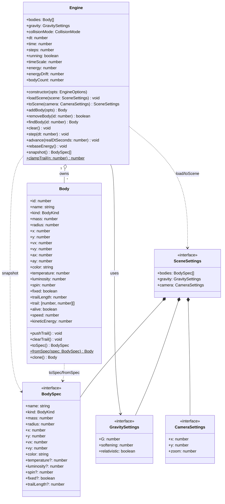

# Class diagram

The type and class model, split across the client physics core and the server
layers. Types that cross the network boundary (`SceneSettings` and friends) are
shown once and referenced from both sides.

> Rendered with Mermaid. PlantUML source: [`class-diagram.puml`](class-diagram.puml).

---

## Simulation core (client)



## Physics modules (client)

```mermaid
classDiagram
    class Renderer {
        +camera: Camera
        +options: RenderOptions
        +resize() void
        +width: number
        +height: number
        +screenToWorld(sx, sy) [number, number]
        +worldToScreen(wx, wy) [number, number]
        +zoomBy(factor, pivot) void
        +pan(dxScreen, dyScreen) void
        +render(bodies: Body[]) void
    }

    class Menu {
        +constructor(root, callbacks)
        +update(state) void
    }

    class MenuCallbacks {
        <<interface>>
        +onNew() void
        +onSave() void
        +onOpen() void
        +onPreset(key: string) void
        +onTogglePlay() void
        +onReset() void
        +onClear() void
        +onToggleTrails() void
        +onToggleGrid() void
        +onToggleVelocity() void
        +onLogin() void
        +onLogout() void
        +onExperiments() void
    }

    class Gravity {
        <<module gravity.ts>>
        +computeAccelerations(bodies, settings) void
        +potentialEnergy(bodies, settings) number
        +kineticEnergy(bodies) number
        +totalEnergy(bodies, settings) number
        +totalMomentum(bodies) [number, number]
        +centerOfMass(bodies) [number, number]
        +circularSpeed(mass, r, G) number
        +escapeSpeed(mass, r, G) number
        +setCircularOrbit(sat, central, G, cw) void
        +isBound(bodies, settings) boolean
    }

    class Collision {
        <<module collision.ts>>
        +detect(bodies) CollisionPair[]
        +bounce(a, b) void
        +merge(a, b) Body
        +resolve(bodies, mode) number
        +prune(bodies) Body[]
    }

    class Relativity {
        <<module relativity.ts>>
        +lorentzFactor(v, c) number
        +relativisticMomentum(m, v, c) number
        +grCorrection(pos, vel, m, src, G, c) Vec
        +perihelionPrecession(a, e, m, G, c) number
        +gravitationalRedshift(m, r, G, c) number
        +aberrate(dir, beta) Vec
    }

    class BlackHole {
        <<module blackhole.ts>>
        +schwarzschildRadius(m, G, c) number
        +photonSphereRadius(m, G, c) number
        +iscoRadius(m, G, c) number
        +shadowRadius(m, G, c) number
        +hawkingTemperature(massKg) number
        +evaporationTime(massKg) number
        +geometry(mass, spin) BlackHoleGeometry
    }

    class Star {
        <<module star.ts>>
        +radiusFromMass(m) number
        +luminosityFromMass(m) number
        +temperatureFrom(m) number
        +colorFromTemperature(k) string
        +classify(m) StarClass
        +lifetimeYears(m) number
        +profile(m) StarProfile
    }

    class RKMethods {
        <<module rkmethods.ts>>
        +eulerStep(f, t, y, h) Vec
        +midpointStep(f, t, y, h) Vec
        +heunStep(f, t, y, h) Vec
        +rk4Step(f, t, y, h) Vec
        +rk45Step(f, t, y, h, tol) RKResult
        +integrate(f, y0, t0, t1, steps) samples
    }

    Renderer --> Body : draws
    Renderer --> CameraSettings : camera
    Menu --> MenuCallbacks : invokes
    Collision --> Body : mutates
    Gravity --> Body : reads/writes
```



---

## Server layers

```mermaid
classDiagram
    class Router {
        <<routes/index.ts>>
        +use('/health', healthRoutes)
        +use('/auth', authRoutes)
        +use('/simulations', simulationRoutes)
        +use('/presets', presetRoutes)
        +use('/experiments', experimentRoutes)
        +use('/bodies', bodyRoutes)
    }

    class Controller {
        <<controllers/*>>
        +registerSchema / loginSchema
        +createSchema / updateSchema / listQuerySchema
        +create(req, res, next)
        +list(req, res, next)
        +getOne(req, res, next)
        +update(req, res, next)
        +remove(req, res, next)
    }

    class Service {
        <<services/*>>
        +create(input, ctx) Simulation
        +list(query) Page~Simulation~
        +getVisible(id, viewerId, role) Simulation
        +update(id, actorId, role, input, ctx) Simulation
        +remove(id, actorId, role, ctx) void
        +play(id, viewerId, role, ctx) Simulation
    }

    class Model {
        <<models/*>>
        +findById(id) Row
        +list(opts) {items, total}
        +create(input) Row
        +update(id, input) Row
        +remove(id) void
        +incrementPlayCount(id) void
        +countForUser(userId) number
    }

    class Pool {
        <<database/pool.ts>>
        +query(sql, params) T
        +execute(sql, params) ResultSetHeader
        +ping() boolean
        +withTransaction(fn) T
        +closePool() void
    }

    class SceneValidator {
        <<services/sceneValidator.ts>>
        +validateBody(raw, index) BodySpec
        +validateScene(raw) SceneSettings
        +validateCategory(raw) PresetCategory
    }

    class AppError {
        +statusCode: number
        +code: string
        +message: string
        +details?: unknown
        +isOperational: boolean
    }

    class Middleware {
        <<middleware/*>>
        +requestId(req, res, next)
        +validate(schemas)
        +optionalAuth(req, res, next)
        +requireAuth(req, res, next)
        +requireRole(...roles)
        +apiLimiter / authLimiter
        +errorHandler(err, req, res, next)
    }

    Router --> Controller : dispatches
    Controller --> Service : calls
    Controller ..> AppError : throws
    Service --> Model : calls
    Service ..> SceneValidator : validates scene
    Model --> Pool : uses
    Middleware ..> Controller : guards
    Middleware ..> AppError : raises
```

---

## Domain types

```mermaid
classDiagram
    class Simulation {
        <<interface>>
        +id: number
        +userId: number
        +name: string
        +description: string|null
        +presetKey: string|null
        +bodyCount: number
        +seed: number|null
        +settings: SceneSettings
        +isPublic: boolean
        +isArchived: boolean
        +playCount: number
        +createdAt: string
        +updatedAt: string
        +owner?: string
    }

    class Preset {
        <<interface>>
        +id: number
        +key: string
        +name: string
        +category: PresetCategory
        +description: string|null
        +difficulty: number
        +settings: SceneSettings
        +isBuiltin: boolean
        +sortOrder: number
        +createdAt: string
    }

    class Experiment {
        <<interface>>
        +id: number
        +simulationId: number|null
        +userId: number
        +label: string
        +integralValue: number|null
        +derivativeAt: number|null
        +energyDrift: number|null
        +samples: number
        +result: unknown
        +measuredAt: string
    }

    class User {
        <<interface>>
        +id: number
        +username: string
        +email: string
        +displayName: string|null
        +role: UserRole
        +isActive: boolean
        +lastLoginAt: string|null
        +createdAt: string
        +updatedAt: string
    }

    class PublicUser {
        <<interface>>
        +id: number
        +username: string
        +displayName: string|null
        +role: UserRole
    }

    class AuthResult {
        <<interface>>
        +user: PublicUser
        +token: string
        +expiresIn: string
    }

    class ApiEnvelope {
        <<interface>>
        +data: T
        +meta?: ApiMeta
    }

    class ApiErrorBody {
        <<interface>>
        +error: {code, message, details?}
    }

    Simulation *-- SceneSettings
    Preset *-- SceneSettings
    User --> PublicUser : projects to
    AuthResult *-- PublicUser
```

## Type reference

| Type | Where | Purpose |
| --- | --- | --- |
| `BodyKind` | client `sim/constants`, server `config/constants` | `star \| planet \| blackhole \| neutron \| dust \| ship` |
| `BodySpec` | shared | Serialisable body (network/DB/JSON) |
| `GravitySettings` | shared | `{ G, softening, relativistic }` |
| `CameraSettings` | shared | `{ x, y, zoom }` |
| `SceneSettings` | shared | `{ bodies, gravity, camera }` |
| `CollisionMode` | client `sim/collision` | `bounce \| merge \| none` |
| `Derivative` | client `lib/rkmethods` | `(t: number, y: Vec) => Vec` |
| `Vec` | client `lib/mathx` | `number[]` |
| `Page<T>` | server | `{ items, page, pageSize, total, totalPages }` |
| `PresetCategory` | server `config/constants` | `blackhole \| stellar \| orbital \| exotic \| sandbox` |
| `UserRole` | server `config/constants` | `user \| admin` |
