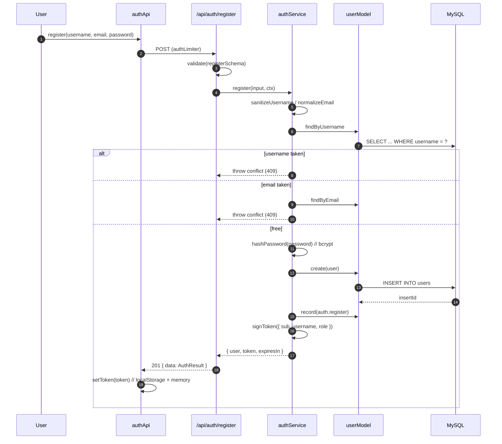
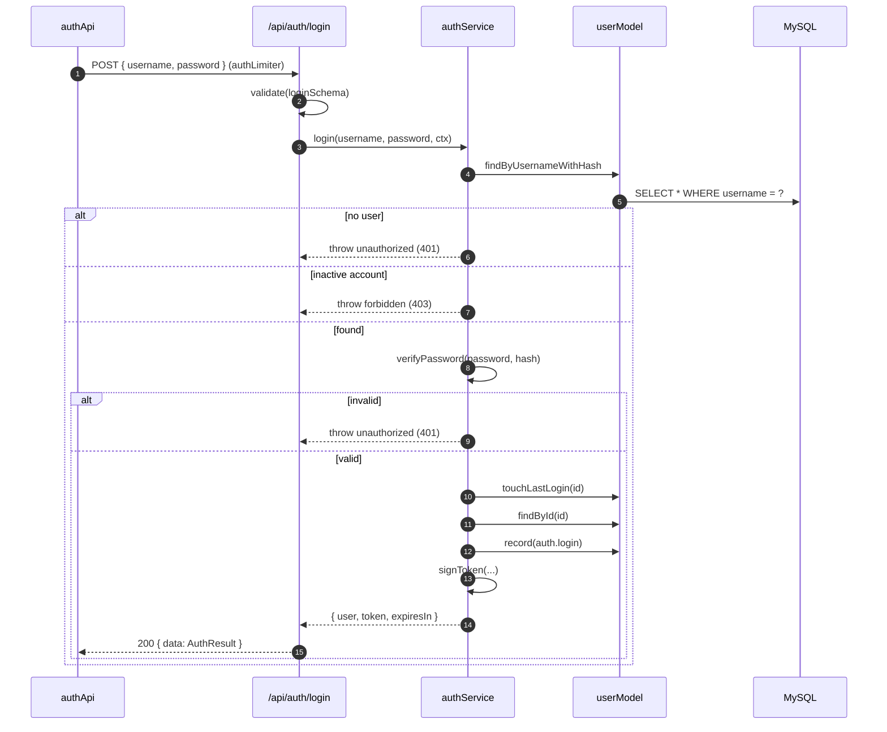
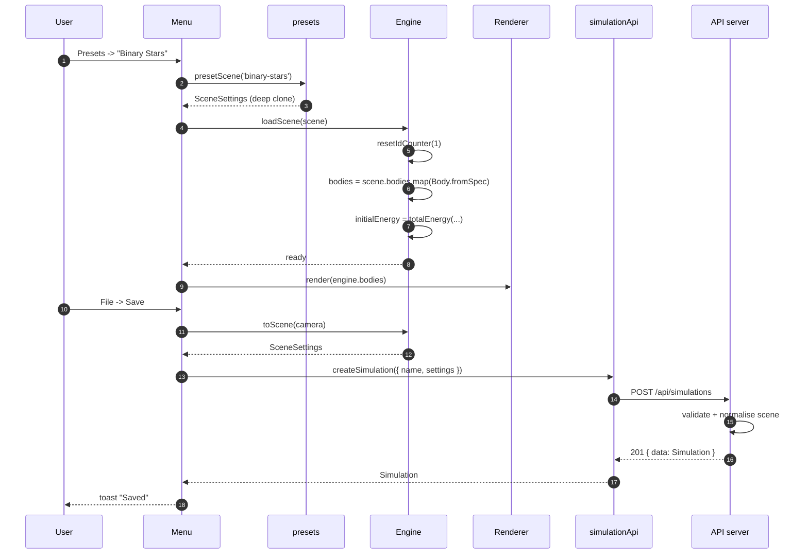
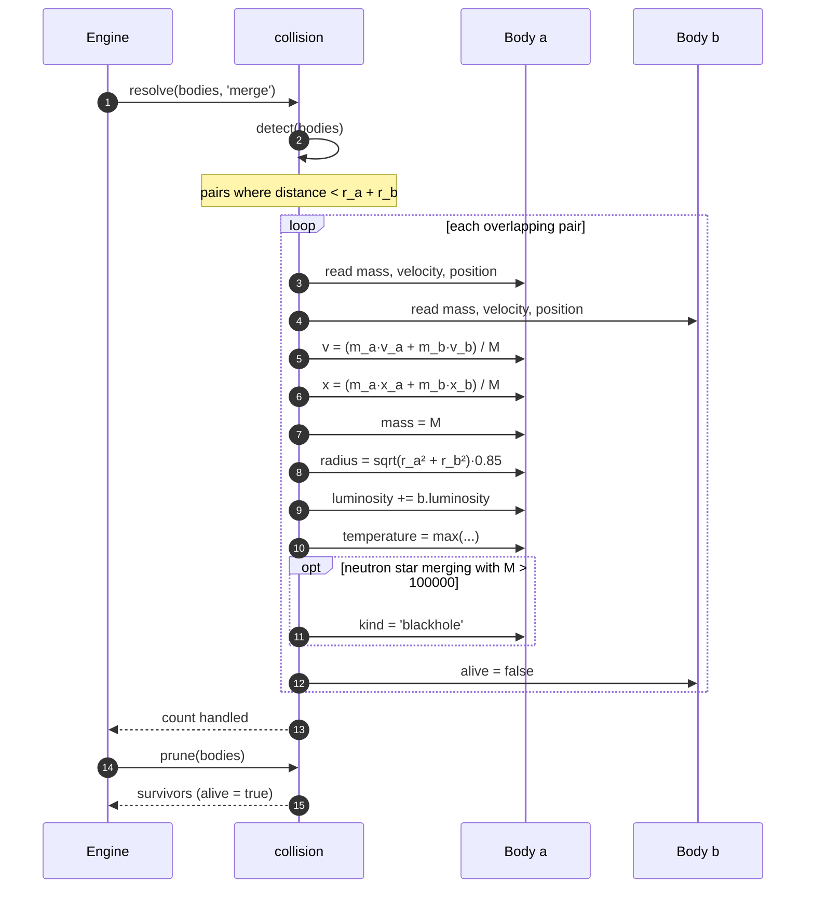
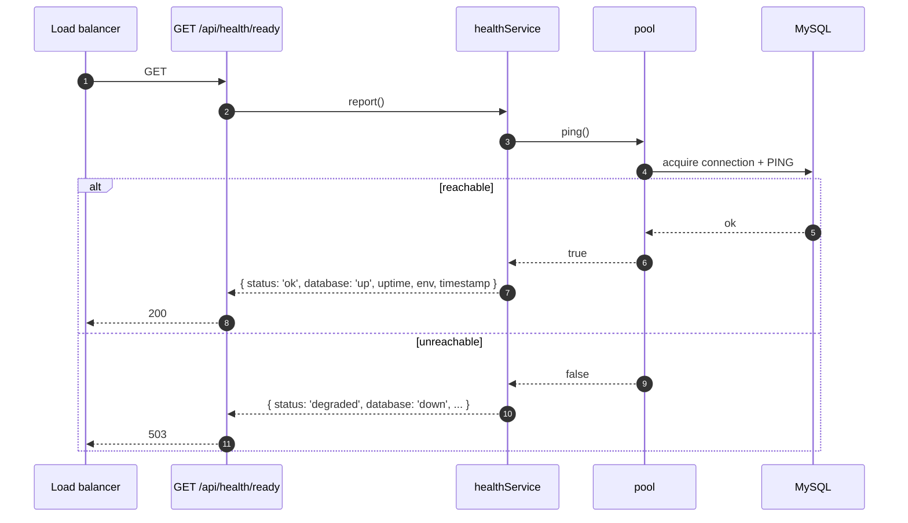

# Sequence diagrams

Runtime interactions across the system: an authenticated API request, the
simulation step loop, registration/login, and saving a scene.

> Rendered with Mermaid.

---

## 1. API request lifecycle (authenticated write)

```mermaid
sequenceDiagram
    autonumber
    participant U as User
    participant C as Client (api client)
    participant M as Middleware chain
    participant R as Route
    participant V as validate (zod)
    participant A as requireAuth
    participant H as Controller
    participant S as Service
    participant Mdl as Model
    participant DB as MySQL

    U->>C: click "Save"
    C->>M: POST /api/simulations (Bearer token, JSON body)
    M->>M: helmet, cors, compression, json, cookieParser
    M->>M: requestId -> X-Request-Id, morgan log
    M->>M: apiLimiter (rate check)
    M->>R: dispatch
    R->>V: validate({ body: createSchema })
    V-->>R: parsed body  (or 400 BAD_REQUEST)
    R->>A: requireAuth
    A->>A: verifyToken -> req.user  (or 401 UNAUTHORIZED)
    R->>H: create(req, res, next)
    H->>S: create({ ...body, userId }, auditContext)
    S->>Mdl: countForUser(userId)
    Mdl->>DB: SELECT COUNT(*) ...
    DB-->>Mdl: count
    Mdl-->>S: count
    alt limit reached
        S-->>H: throw conflict (409)
        H-->>C: next(err)
    else within limit
        S->>S: validateScene(settings)  // clamp + check
        S->>Mdl: create(input)
        Mdl->>DB: BEGIN; INSERT simulation; INSERT bodies; COMMIT
        DB-->>Mdl: insertId
        Mdl-->>S: Simulation
        S->>Mdl: eventModel.record(sim.create)
        Mdl->>DB: INSERT api_events (fire-and-forget)
        S-->>H: Simulation
        H->>C: 201 { data: Simulation }
    end
    C-->>U: toast "Saved"
```

Any thrown error is forwarded with `next(err)` and terminated by the central
`errorHandler`, producing `{ error: { code, message, details? } }`.

---

## 2. Simulation step loop (client)

```mermaid
sequenceDiagram
    autonumber
    participant RAF as requestAnimationFrame
    participant E as Engine
    participant B as Body[]
    participant G as gravity
    participant RK as rk4Step
    participant X as collision
    participant R as Renderer

    RAF->>E: advance(realDt)
    E->>E: target = max(MIN_DT, dt)·timeScale
    E->>E: sub = clamp(round(target/dt), 1, MAX_SUBSTEPS)
    loop sub times (h = target/sub)
        E->>E: step(h)
        E->>E: pack state y = [x…, y…, vx…, vy…]  (length 4n)
        loop RK4 stages k1..k4
            E->>B: write candidate state into bodies
            E->>G: computeAccelerations(bodies, settings)
            G-->>E: writes a.ax / a.ay
            E->>B: restore saved state
        end
        E->>RK: rk4Step(f, time, state, h)
        RK-->>E: next state
        E->>B: write next state into bodies
        E->>E: time += h; steps++
        alt collisionMode != 'none'
            E->>X: resolve(bodies, mode)
            X->>B: merge(a,b) or bounce(a,b)
            E->>X: prune(bodies)
            X-->>E: survivors
        end
        E->>B: pushTrail() for each body
    end
    E-->>RAF: done
    RAF->>R: render(engine.bodies)
    R-->>RAF: frame drawn
```

---

## 3. Registration



## 4. Login



---

## 5. Loading a preset and saving the scene



---

## 6. Collision resolution (merge)



---

## 7. Readiness probe


